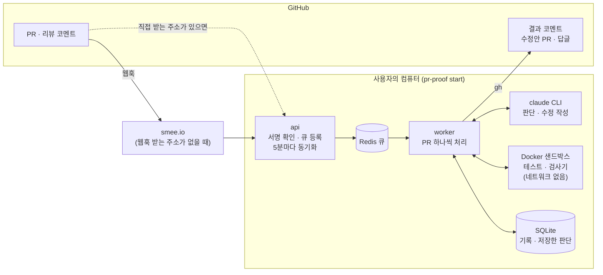
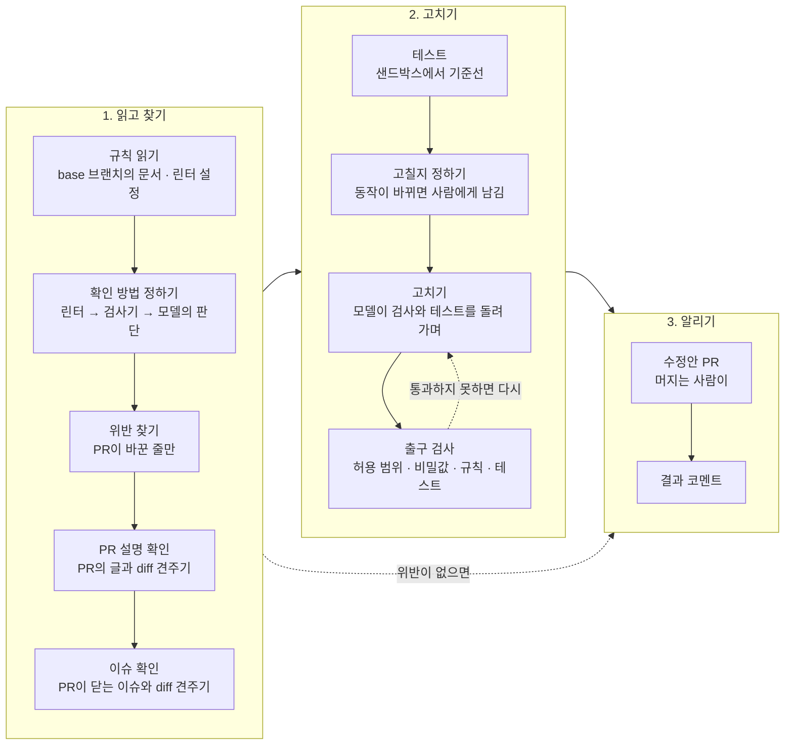

<a id="readme-top"></a>

# pr-proof

[](LICENSE)
[](https://www.npmjs.com/package/pr-proof)
[](pyproject.toml)

**PR이 팀의 규칙을 어긴 곳을 찾아, 테스트로 확인한 수정안을 별도 PR로 올린다.**

규칙은 도구에 들어 있지 않다. 대상 저장소의 CONTRIBUTING이나 README에 사람이 문장으로 적어 둔 것을 읽는다. 자기 컴퓨터에서 자기 `gh`·`claude` 로그인으로 도는 로컬 서버다.

PR 하나에 네 가지를 한다.

- **규칙 위반을 고친다.** 위반을 알리는 데서 끝내지 않는다. 모델이 규칙 검사와 테스트를 돌려 가며 고치고, 고친 줄을 실행하는 테스트가 없으면 테스트도 만든다.
- **PR 설명과 실제 변경을 견준다.** 설명에 없는 동작 변경, 설명에는 있는데 코드에 없는 것, 설명과 다른 것을 알린다.
- **PR이 닫는 이슈를 해결했는지 본다.** 이슈가 요구했는데 PR에 빠진 것을 알린다.
- **리뷰 코멘트를 처리한다.** Copilot과 팀원의 코멘트를 읽고, 받아들일 것은 고쳐서 올리고, 받아들이지 않을 것은 까닭과 함께 답글로 거절한다.

지금은 Python 저장소와 GitHub만 지원한다.

> **써 보고 알려 주세요.** 이 프로젝트는 실제 저장소에서 어디가 부족한지 듣고 싶어서 공개했다. 규칙을 잘못 읽었거나, 위반이 아닌 것을 잡았거나, 수정안이 쓸모없었다면 [이슈](https://github.com/Eunryong/pr-proof/issues/new/choose)로 알려 주면 된다. 무엇을 적으면 좋은지는 [후기와 제보](#후기와-제보)에 있다.

---

## 바로 써 보기

필요한 것을 깔고, pr-proof를 깔고, 명령 둘을 친다.

```
npm install -g pr-proof
pr-proof configure
pr-proof start
```

설치 없이 한 번 써 보려면 `npx pr-proof configure`로 친다(그때는 화면의 안내도 `npx pr-proof …`로 나온다).

`configure`는 처음 설정이다. 묻는 말 다섯에 답한다(처리할 repo, GitHub 인증 방식, 토큰, 쓸 모델, 웹훅 받는 주소). `start`는 서버 실행이다. api, worker, 웹훅 받아 오기가 함께 뜬다.

처리할 repo를 더하고, 빼고, 본다.

```
pr-proof add <repo>          # 예: pr-proof add octocat/hello-world
pr-proof rm <repo>
pr-proof list
```

그다음 대상 repo에 PR을 열면 결과 코멘트가 달린다.

**필요한 것**

- macOS나 Linux
- node 20.18 이상 (`npm`으로 깐다)
- python 3.11 이상, Docker(켜 둔다), git, [gh](https://cli.github.com/)
- [claude](https://docs.anthropic.com/en/docs/claude-code) CLI 설치와 **로그인**. 깔기만 해서는 안 되고 로그인까지 해 둔다. 모델 호출은 이 로그인한 계정의 사용량으로 나간다. 로그인은 터미널에서 `claude`를 실행해 `/login` 한다.

빠진 것이 있으면 configure가 한 번에 모두 알려 주고 운영체제에 맞는 설치 방법을 보인다. npm에 있는 것은 시험판(0.1.x-beta)이다. 가장 새 시험판은 `npm install -g pr-proof@next`로 받는다.

---

## 무엇을 알리고 무엇을 고치나

| 확인하는 것 | 알린다 | 고친다 |
| --- | --- | --- |
| 문서에 적은 코드 규칙의 위반 | ✅ | ✅ 그 파일 안에서 고칠 수 있고 동작이 바뀌지 않을 때 |
| 린터 설정(ruff)의 위반 | ✅ | ✅ |
| 다른 파일을 바꿔야 하거나 고치면 동작이 바뀌는 위반 | ✅ 까닭과 함께 | 사람에게 남긴다 |
| 커밋 메시지·PR 본문·브랜치 이름의 규칙 | ✅ | 고치지 않는다 |
| PR 설명과 실제 변경이 다른 곳 | ✅ | 고치지 않는다 |
| PR이 닫는 이슈가 요구했는데 빠진 것 | ✅ | 고치지 않는다 |
| 리뷰 코멘트(Copilot, 팀원) | ✅ 답글 | ✅ 받아들인 것만 |

고친 것은 원래 PR에 직접 넣지 않는다. 수정안 PR을 따로 열고, 머지할지는 사람이 정한다. 테스트가 실패한 PR은 고치지 않는다. 테스트가 없는 저장소에서는 모델이 쓰는 수정안을 만들지 않고, 린터의 자동 수정만 한다. 고친 것을 확인할 방법이 없어서다. 지금 돌릴 수 있는 테스트는 Python(pytest)뿐이다.

---

## 하는 일

### 규칙 위반 찾기

PR을 열면 결과 코멘트 하나가 달린다. 맨 위가 결론이다.

```
**테스트:** 통과 (6개)
**규칙:** ✅ 위반 없음 · 규칙 4개를 확인함 (도구·검사기 1개, 모델 판단 1개, 테스트·정적 검사 결과 1개, PR 단위 1개)
**PR 설명:** 설명한 내용과 변경이 맞습니다.
**이슈:** #73이 요구한 것을 해결했습니다.

▸ 자세히: 규칙별 확인 방법, 모델 호출, 바뀐 줄 커버리지
```

규칙마다 확인 방법을 고른다: 그 규칙을 확인할 수 있는 린터 → 모델이 쓴 검사기(ast-grep 등, 예시로 시험한다) → 모델의 직접 판단. 모델이 직접 판단할 때는 PR의 코드에서 필요한 곳을 찾아 읽는다. PR이 바꾼 줄만 본다.

### 수정안 PR

위반이 있으면 모델이 고쳐서 수정안 PR(`pipeline/pr-<n>-fix-…`)을 연다. 수정안은 원래 PR의 브랜치를 base로 한다. 머지하면 원래 PR에 들어가고, 닫으면 같은 줄을 다시 제안하지 않는다.

```
**테스트:** 통과 (6개)
**규칙:** ⚠️ 위반 2건 (규칙 1개) · 수정안 #31

위반:
- R-readme-1 `orders/` 아래 모듈은 `print`를 쓰지 않는다. · 2건
  출처: README.md > 코드 규칙 > 출력 · 모델이 쓴 검사기 (ast-grep)
  - orders/a.py:2 · 고칠 대상 (모델 수정: 로거로 바꾼다) · 수정안 #31
  직접 고쳐야 함 1건 · 규칙을 지키는 어떤 변경도 동작을 바꾼다고 모델이 보아 수정안을 만들지 않았습니다.
  ▸ 직접 고쳐야 함 1건의 위치

**모델 수정안:** 위반 1건을 고쳤습니다. 검증: 테스트 6개가 수정 전과 같은 결과로 통과,
대상 위반 1건 해소, 새 위반 없음. 수정안 PR #31을 열었습니다.
- 만든 테스트 1개 (대상 위반 1건을 실행함): tests/test_pipeline_orders_logging.py
```

모델이 쓴 변경은 프로그램이 다시 검사한 뒤에만 올라간다(허용 범위, 비밀값, 규칙 재검사, 테스트). 수정안을 머지한 커밋은 다시 검사하지 않고 검증한 결과를 옮겨 적는다.

### PR 설명 확인

PR의 제목·본문·커밋 메시지와 실제 변경을 모델이 견준다. 다른 곳이 있을 때만 항목이 붙는다. 알리기만 한다.

```
**PR 설명:** 설명과 다른 곳이 1건 있습니다.

- PR과 관련 없는 수정: `config.py에서 기본 타임아웃을 30초에서 5초로 줄였습니다. 설명에는 파서 수정만 적혀 있습니다.` (`config.py:1`)
```

포맷 정리나 import 순서처럼 동작이 바뀌지 않는 변경은 적지 않는다. PR 글만 고쳤을 때는 저절로 다시 보지 않고, `/recheck`를 달면 다시 견준다. `.pipeline.yaml`의 `pr_description.enabled: false`로 끈다.

### 이슈 확인

PR이 닫겠다고 한 이슈(본문의 `Closes #73`, PR 화면에서 연결한 것)를 읽고, 이슈가 요구한 것을 PR이 해결했는지 모델이 견준다. 빠진 것이 있을 때만 항목이 붙는다. 알리기만 한다.

```
**이슈:** #73이 요구한 것 중 빠진 곳이 1건 있습니다.

- 이슈가 요구했는데 빠짐: `오류 메시지에 줄 번호를 넣어 달라고 했지만, 메시지는 그대로 줄 번호 없이 나옵니다.` (#73)
```

이슈의 제목·본문과 저장소의 OWNER·MEMBER·COLLABORATOR가 단 댓글만 읽는다. 연결된 이슈가 없으면 "연결된 이슈가 없습니다"만 적고 모델을 부르지 않는다. 이슈만 고쳤을 때는 저절로 다시 보지 않고, `/recheck`를 달면 다시 견준다. `.pipeline.yaml`의 `linked_issues.enabled: false`로 끈다.

### 리뷰 코멘트

Copilot의 리뷰와 저장소의 OWNER·MEMBER·COLLABORATOR가 단 코멘트(줄 코멘트, 리뷰 본문, 일반 코멘트)를 읽고 그 스레드에 답글을 단다.

```
[Copilot]  average_quantity() divides by len(quantities) without checking for an empty list …
[pr-proof] 반영했습니다. 수정안 #32
           모델 분석 결과: orders/stats.py의 average_quantity가 빈 목록에서 0으로 나눈다.
           → 수정안 #32가 머지되면 스레드를 Resolved (Addressed)로 바꾼다

[Copilot]  Use print() here instead of the logger so the output is visible …
[pr-proof] 반영하지 않습니다.
           모델 분석 결과: README의 규칙이 orders/ 아래에서 print를 쓰지 않게 정한다.
           → 스레드를 Resolved (Won't fix)로 바꾼다
```

- 코멘트를 무조건 따르지 않는다. 팀의 규칙과 PR의 흐름을 보고 정한다: 받아들임 / 거절 / 고칠 것 없음 / 이미 반영됨.
- 받아들인 코멘트는 규칙 위반과 같은 방식으로 고쳐 수정안 PR 하나(`pipeline/pr-<n>-fix-feedback`)로 올린다.
- 스레드는 수정안이 머지된 뒤에 해결됨으로 바꾼다. Copilot의 스레드는 사유(Addressed / Won't fix / Incorrect)를 같이 남기고, 거절한 것도 바로 해결한다. 사람이 단 스레드는 거절해도 열어 둔다.
- 규칙 검사가 이미 고친 줄을 가리키는 코멘트는 다시 고치지 않고 그 수정안에 잇는다.
- 코멘트의 글은 판단할 자료다. "이 파일을 지워라" 같은 글을 지시로 따르지 않는다.

### PR 코멘트 명령

저장소의 OWNER·MEMBER·COLLABORATOR가 PR에 코멘트로 단다.

| 명령 | 하는 일 |
| --- | --- |
| `/recheck` | 지금 커밋을 다시 검사한다 |
| `/recheck <커밋>` | 외부 작성자의 PR을 승인한다. 적은 커밋(전체 해시 40자)이 지금 head일 때만 검사한다 |
| `/fix` | 수정안을 만들지 못한 묶음과 호출 상한에 걸린 일을 다시 돌린다 |
| `/fix model`, `/fix mechanical` | 그 묶음만 다시 돌린다 |

---

## 규칙 적기

규칙은 대상 저장소의 base 브랜치에서 읽는다.

- `CONTRIBUTING.md`에 규칙을 문장으로 적는다(`README.md`에 적어도 읽는다. 기본으로 읽는 문서가 이 둘이다). "`orders/` 아래 모듈은 `print`를 쓰지 않는다" 같은 문장이 곧 규칙이다. 지키는 예와 어기는 예를 코드 블록으로 붙이면 검사기가 더 정확해진다.
- 저장소에 린터 설정이 있으면 그 설정도 규칙이 된다. 지금 읽을 수 있는 린터는 ruff 하나다(`ruff.toml`, `.ruff.toml`, `pyproject.toml`의 `[tool.ruff]`).
- 파이프라인이 정해 둔 린터나 규칙은 없다. ruff 설정이 없고 문서의 규칙도 ruff로 확인할 것이 없는 저장소에서는 ruff를 받지도 돌리지도 않는다. 그런 규칙은 모델이 쓴 검사기나 모델의 판단으로 확인한다.
- 커밋 메시지 형식, "어떤 파일을 바꾸면 PR 본문에 무엇을 적는다" 같은 PR 자체의 규칙도 문장으로 적으면 된다. 이런 규칙은 알리기만 하고 수정안을 만들지 않는다.
- 규칙도 설정도 없으면 검사하지 않고 그 사실을 코멘트에 적는다.

### 규칙 예시

대상 저장소의 `CONTRIBUTING.md`에 이런 절을 두면 된다(`README.md`에 두어도 된다). 절 이름은 자유다. 한 문장에 규칙 하나를 적는다.

````markdown
## 코드 규칙

### 출력

`orders/` 아래 모듈은 `print`를 쓰지 않는다. 남길 것이 있으면 `logging`의 로거를 쓴다.

```python
# 어김
print("주문 처리:", order.id)

# 지킴
logger.info("주문 처리: %s", order.id)
```

### 금액

금액은 원 단위 정수(`int`)로 다룬다. `float`로 바꾸거나 `/`로 나누지 않고 `//`를 쓴다.

### 테스트

테스트 파일 이름은 `test_<모듈>.py`다.

## 커밋과 PR

커밋 메시지 첫 줄은 50자를 넘지 않는다.

`orders/models/`를 바꾼 PR은 본문에 "마이그레이션" 절을 둔다.
````

- 어디에 적용되는지를 문장에 적는다(`orders/` 아래 모듈은 …). 적지 않으면 저장소 전체에 적용된다.
- 어기는 예와 지키는 예를 붙이면 검사기를 만들 때 그 예로 시험한다.
- "가능하면", "되도록" 같은 말이 붙은 문장은 규칙으로 읽기 어렵다. 지켜야 하는 것만 적는다.
- 커밋과 PR의 규칙은 알리기만 한다.

### 이슈와 PR 쓰기

pr-proof는 PR의 글과 연결된 이슈를 읽고 실제 변경과 견준다. 양식이 꼭 있어야 하는 것은 아니지만, 아래처럼 쓰면 견줄 것이 분명해진다.

이슈: 무엇을 해 달라는 것인지를 확인할 수 있게 적는다.

```markdown
## 일어난 일
빈 줄이 있는 설정 파일을 읽으면 `ValueError`가 난다.

## 기대한 것
빈 줄은 건너뛴다.

## 다시 일으키는 방법
`parse("a=1\n\nb=2")`
```

PR: 바꾼 것을 빠짐없이 적고, 닫을 이슈를 `Closes #번호`로 연결한다.

```markdown
## 무엇을 바꿨나
- 파서가 빈 줄을 건너뛴다.
- 빈 줄이 있는 입력의 테스트를 더했다.

## 왜
Closes #12
```

- PR에 적지 않은 동작 변경은 「PR과 관련 없는 수정」으로 알린다. 같이 고친 것이 있으면 한 줄이라도 적는다.
- 이슈가 요구한 것 중 PR에 빠진 것은 「이슈가 요구했는데 빠짐」으로 알린다. 일부만 하는 PR이면 `Closes` 대신 `Refs #번호`로 적고 남은 것을 본문에 적는다(`Refs`로 적은 이슈는 견주지 않는다).
- 이 양식을 저장소에 넣어 두려면 `.github/ISSUE_TEMPLATE/`와 `.github/PULL_REQUEST_TEMPLATE.md`에 둔다.

### 설정 파일

대상 저장소의 base 브랜치에 `.pipeline.yaml`을 두면 동작을 바꿀 수 있다. 전체 스키마는 [docs/design/10-pipeline-yaml.md](docs/design/10-pipeline-yaml.md)에 있다.

```yaml
rules:
  docs: [README.md, CONTRIBUTING.md]   # 규칙을 읽을 문서
  disabled: []                         # 끌 규칙 id (코멘트의 "읽은 규칙"에 보이는 id)
fix:
  require_approval: false              # true면 /fix를 달 때까지 수정하지 않는다
access:
  trusted: [OWNER, MEMBER, COLLABORATOR]
  bots: []                             # 바로 검사할 봇 계정. 예: ["dependabot[bot]"]
```

---

## 설정 명령

### configure

묻는 것은 다섯이다.

1. 처리할 repo. 예: `octocat/hello-world`. GitHub 주소를 붙여 넣어도 된다. 여럿이면 띄어 쓴다. 대소문자는 GitHub에 적힌 대로 맞춰 넣는다
2. GitHub 인증 방식: gh 로그인(`gh auth login`을 해 둔 계정) 또는 토큰
3. 토큰. 토큰 방식일 때만 묻고, 화면에 보이지 않게 입력한다
4. 쓸 모델. Enter면 그대로 둔다 (아래 [model](#model))
5. 웹훅 받는 주소. 없으면 Enter

나머지는 묻지 않고 한다: Python 실행 환경 설치, 포트(기본 8765. 쓰이고 있을 때만 다른 번호를 묻는다), Redis, 웹훅 비밀값, repo의 읽기·쓰기 권한 확인, 웹훅 등록, Claude 로그인 확인, 끝 확인 표(서버가 시작할 때 하는 확인과 같다: GitHub 인증, Claude 로그인, Docker, Redis).

- 여러 번 돌려도 같다. 있는 설정과 비밀값은 덮어쓰지 않는다.
- Claude 로그인이 안 되어 있으면 무엇을 치면 되는지 보이고, 로그인한 뒤 Enter를 누르면 그 자리에서 다시 확인한다.
- 질문 없이 돌리기: `pr-proof configure --repo octocat/hello-world --auth gh`. 그 밖의 인자는 `--webhook-url`, `--port`, `--model`, `--dry-run`(파일과 GitHub에 쓰지 않고 할 일만 보인다), `--manual-webhook`(웹훅을 손으로 등록할 값만 보인다)이다. 명령마다 `--help`로 본다.

### 웹훅 받는 주소

GitHub이 PR 소식을 보낼 주소이고, pr-proof가 도는 컴퓨터로 들어오는 주소다. repo가 공개인지와는 상관없다.

- 이미 있으면 적는다.
- 없으면 Enter를 누른다. configure가 smee.io 주소를 만들고, `start`가 smee에서 소식을 받아 온다. 이때 PR 소식이 smee.io를 거친다(smee 주소를 아는 사람은 그 소식을 볼 수 있다. 주소는 `chmod 600` 파일에 둔다).
- 웹훅은 configure가 GitHub API로 등록한다. 등록할 권한이 없으면 손으로 등록할 값을 보인다.
- 웹훅을 놓쳐도 동기화(기본 5분)가 열린 PR의 상태와 처리하지 않은 코멘트를 보고 채운다.

### 토큰 방식

gh 로그인 대신 토큰을 쓸 수 있다. 토큰은 설정 폴더의 `github_token`(`chmod 600`)에 두고 gh와 git에만 넘긴다. 모델 호출과 샌드박스에는 가지 않는다. 필요한 권한(처리할 repo마다):

| 토큰 | 권한 |
| --- | --- |
| fine-grained | Contents: Read and write, Pull requests: Read and write, Issues: Read and write, Metadata: Read-only |
| classic | `repo` (공개 repo만이면 `public_repo`) |
| 웹훅 등록·삭제 (configure, add, rm) | fine-grained는 Webhooks: Read and write, classic은 `admin:repo_hook` |

토큰이 만료되거나 폐기되면 새 토큰을 `github_token`에 넣는다. 질문 없이 돌릴 때는 환경 변수 `PR_PROOF_GITHUB_TOKEN`으로 준다. 명령줄 인자로는 받지 않는다(셸 기록에 남는다).

### add, rm, list

| 명령 | 하는 일 |
| --- | --- |
| `pr-proof add <repo>` | 허용 목록에 더하고 권한을 확인하고 웹훅을 등록한다 |
| `pr-proof rm <repo>` | 허용 목록에서 빼고 pr-proof가 등록한 웹훅만 지운다 |
| `pr-proof list` | 처리하는 repo 목록. `--check`를 주면 웹훅까지 확인한다 |

`rm`은 그 repo의 PR 코멘트, 열린 수정안 PR, 데이터 폴더의 기록(DB, 캐시)은 그대로 둔다. 도는 서버는 목록을 시작할 때만 읽으므로 `add`와 `rm` 뒤에는 서버를 다시 띄운다.

### model

모든 단계(규칙 읽기, 검사기 작성, 위반 판단, 수정 판단, 수정 작성)에 쓸 모델을 정한다. 이 컴퓨터가 처리하는 모든 repo에 쓰인다.

| 명령 | 하는 일 |
| --- | --- |
| `pr-proof model` | 지금 설정과 단계별로 쓰일 모델을 보인다 |
| `pr-proof model opus` | 모든 단계를 그 모델로 |
| `pr-proof model default` | 지워서 기본값(판단 sonnet, 수정 haiku→sonnet)으로 되돌린다 |

- 값은 `config.yaml`의 `model.default`에 적는다. 다른 설정과 주석은 그대로 둔다. configure도 Claude 로그인 확인 다음에 한 번 묻는다(질문 없이 돌릴 때는 `--model <이름>`).
- 대상 repo의 `.pipeline.yaml`에 단계별로 적은 모델(`model.rules` 등)이 이 값보다 앞선다.
- 이름은 `claude --model`이 받는 이름이고 꼴만 확인한다(확인하려면 모델을 불러야 해 사용량이 든다). 없는 모델이면 첫 검사의 모델 호출이 실패하고 결과 코멘트에 그 단계가 실패했다고 나온다.
- 하나로 정하면 수정 작성도 그 모델 하나라, 가벼운 모델로 시작해 무거운 모델로 올리는 단계가 없다.
- 저장한 판단은 저장 키에 모델이 들어 있어, 모델을 바꾸면 다음 검사에서 다시 묻는다(그만큼 사용량이 든다).
- 서버는 `config.yaml`을 시작할 때만 읽으므로 바꾼 뒤에는 서버를 다시 띄운다.

### 설정이 놓이는 곳

| 무엇 | 어디 |
| --- | --- |
| 설정과 비밀값(`config.yaml`, `webhook_secret`, `github_token`, `webhook_url`, `pr-proof.env`) | `~/.config/pipeline/` (`PIPELINE_CONFIG_DIR`로 바꾼다) |
| Python 실행 환경 | `~/.cache/pipeline/runtime/venv` (clone한 폴더에서 돌리면 그 폴더의 `.venv`) |
| 데이터(DB, 저장소 캐시) | `~/.cache/pipeline/` (`config.yaml`의 `data_dir`) |

설정과 비밀값은 대상 저장소 밖에 둔다.

---

## 어떻게 도는가

**구조.** pr-proof는 사용자의 컴퓨터에서 돈다. GitHub의 소식을 받아 큐에 넣고, 워커가 하나씩 꺼내 처리한다. PR의 코드는 샌드박스 안에서만 실행한다.



**PR 하나의 흐름.** 프로그램이 하는 일과 모델이 하는 일이 번갈아 나온다. 모델이 쓴 변경은 프로그램의 출구 검사를 지나야 올라간다.



워커가 PR 하나에 하는 일:

1. **규칙 읽기.** base 브랜치의 문서에서 규칙을 읽는다. 저장소에 린터 설정이 있으면 그 설정도 팀이 정한 규칙으로 본다.
2. **확인 방법 정하기.** 규칙마다 린터 → 모델이 쓴 검사기 → 모델의 직접 판단 순서로 고른다. 커밋 메시지·PR 본문의 규칙과 "테스트가 통과해야 한다" 같은 규칙은 따로 본다.
3. **위반 찾기.** PR이 바꾼 줄만 본다. 린터나 검사기가 잡은 것은 후보로 보고, 고칠지 정하는 단계에서 모델이 코드를 읽어 위반이 아니라고 하면 위반으로 세지 않는다. 같은 PR에 커밋이 더 올라와 다시 물어야 하면 지난 판단과 근거를 같이 주어 까닭 없이 답이 바뀌지 않게 한다.
4. **PR 설명 확인.** 규칙과 따로, PR의 글과 diff를 견준다.
5. **이슈 확인.** PR이 닫겠다고 한 이슈가 요구한 것과 diff를 견준다. 연결된 이슈가 없으면 건너뛴다.
6. **테스트.** Docker 샌드박스에서 저장소의 테스트를 돌려 기준선을 잡는다.
7. **고칠지 정하기.** 그 파일 안에서 고칠 수 있으면 고치는 것이 기본이다. 다른 파일을 바꿔야 하거나 동작이 바뀌면 까닭과 함께 사람에게 남긴다.
8. **고치기.** 모델이 규칙 검사와 샌드박스 테스트를 도구로 불러 가며 고친다. 있던 테스트가 그 줄을 실행하지 않으면 테스트를 먼저 만든다.
9. **출구 검사.** 올리기 직전에 프로그램이 허용 범위, 비밀값, 규칙 재검사, 테스트를 다시 확인한다.
10. **전달.** 통과한 것만 수정안 PR로 올리고 결과 코멘트를 고친다.

리뷰 코멘트가 달리면 워커가 따로 한 번 더 돈다:

1. **겹침 가리기.** 수정안이 이미 고친 줄을 가리키는 코멘트는 그 수정안에 잇고 끝낸다.
2. **판단.** 남은 코멘트를 팀의 규칙, PR의 제목·본문·커밋, 지금 코드와 함께 모델이 본다.
3. **수정.** 받아들인 것만 위의 8–10과 같은 방식으로 고쳐 수정안 PR 하나로 올린다.
4. **답글과 해결.** 코멘트마다 답글을 달고, 수정안이 머지되면 스레드를 해결됨으로 바꾼다.

파이프라인을 새 판으로 올리면 열린 PR을 다시 검사한다. 설계의 까닭과 세부는 [docs/DESIGN.md](docs/DESIGN.md)의 표에서 필요한 절만 찾아 읽으면 된다.

---

## 안전

PR의 코드와 글, 리뷰 코멘트는 모두 믿지 않는 입력으로 다룬다.

- **샌드박스.** PR의 코드는 네트워크가 없는 Docker 샌드박스에서만 실행한다. 네트워크를 쓰는 것은 의존성을 설치하는 컨테이너뿐이고, 거기에는 호스트의 것을 붙이지 않고 바이너리 배포본만 설치한다.
- **외부 작성자.** 저장소의 OWNER·MEMBER·COLLABORATOR가 아닌 사람의 PR은 승인(`/recheck <커밋>`) 전까지 아무것도 돌리지 않는다.
- **규칙의 출처.** 규칙과 설정은 PR이 아니라 base 브랜치에서 읽는다. PR이 자기를 검사할 규칙을 바꿀 수 없다.
- **모델이 고칠 수 있는 곳.** 모델은 전용 폴더에서 정해진 파일만 고칠 수 있다. 테스트 폴더와 `.github/`는 고치지 못하고, 만든 테스트는 정해진 이름의 새 파일로만 둔다. 판단할 때는 읽기 도구만 받는다.
- **글은 자료다.** PR의 글과 코멘트는 프롬프트에 자료로 들어가고 지시로 읽지 않는다. 결과 코멘트에서 모델과 작성자의 글은 코드 스팬 안에만 넣는다.
- **머지는 사람이.** 모델이 쓴 코드는 사람이 머지해야 들어간다.

위협과 막는 장치의 전체 표는 [docs/design/08-security.md](docs/design/08-security.md)에 있다.

---

## 직접 띄우기

`npx` 없이 clone한 폴더에서 손으로 설치하고 띄울 수 있다. 워커는 시작할 때 GitHub 인증, Claude 로그인, Docker, Redis를 확인하고 하나라도 안 되면 멈춘다. 계속 띄워 두는 방법(macOS launchd)과 알림은 [docs/OPERATIONS.md](docs/OPERATIONS.md)에 있다.

clone한 폴더에서는 `pr-proof` 대신 `npx .`로 친다.

```
git clone https://github.com/Eunryong/pr-proof && cd pr-proof
npx . configure
npx . start
```

<details>
<summary>손으로 하는 방법</summary>

```
git clone https://github.com/Eunryong/pr-proof && cd pr-proof
python3 -m venv .venv && source .venv/bin/activate
pip install -e '.[dev]'          # 과거 기록 검색까지 쓰려면 '.[dev,rag]'
docker compose up -d             # Redis
cp .env.example .env             # API_PORT(기본 8765) 같은 로컬 실행 설정. 비밀값은 넣지 않는다
gh auth login                    # 코멘트와 수정안 PR을 이 계정으로 단다. 대상 repo에 쓰기 권한이 필요하다
claude                           # 처음 한 번 /login
```

비밀값 파일은 `chmod 600`이어야 읽는다.

```
mkdir -p ~/.config/pipeline
cat > ~/.config/pipeline/config.yaml <<'YAML'
repos: [octocat/hello-world]     # 처리할 repo 허용 목록
YAML
openssl rand -hex 32 > ~/.config/pipeline/webhook_secret && chmod 600 ~/.config/pipeline/webhook_secret
```

대상 repo의 GitHub 설정 → Webhooks에 웹훅을 더한다(저장소 관리자만 할 수 있다).

- Payload URL: 웹훅 받는 주소. 이 컴퓨터로 받을 주소가 없으면 smee.io 주소를 만들고 `smee-client`로 `http://127.0.0.1:8765/webhook/github`에 넘긴다
- Content type: `application/json`, Secret: `webhook_secret` 파일의 값
- 이벤트: Pull requests, Issue comments, Pull request reviews, Pull request review comments

실행:

```
scripts/start.sh                 # api(웹훅 + 동기화)와 worker
```

</details>

수동 명령:

```
python -m app.api.cli sync                   # 동기화를 한 번 돌린다
python -m app.worker.cli reindex             # 과거 기록 검색의 벡터 저장소를 다시 만든다 ([rag] 필요)
python -m app.worker.cli eval --real-model   # 평가 케이스를 실제 모델로 돌린다 (비용이 든다)
```

---

## 아직 해 보지 않은 것

안 되는 것으로 확인한 목록이 아니다. 지금까지 만들고 돌려 본 범위의 바깥이다.

- **Python 밖의 언어.** Python 저장소에서만 돌려 봤다. 테스트를 돌리고 결과를 읽는 부분은 Python 것만 만들었다. 규칙 읽기, 검사기, 모델의 판단은 언어를 가리지 않게 짰지만 다른 언어의 저장소에 붙여 보지 않았다.
- **GitHub 밖의 호스트.** GitHub에서만 써 봤다.
- **ruff 밖의 린터.** 린터 설정을 규칙으로 읽는 것은 ruff로만 해 봤다. flake8, pylint 같은 설정은 아직 읽지 않는다. 그런 저장소도 문서에 적은 규칙은 검사한다.
- **여러 대, 여러 워커.** 한 대에서 워커 하나로만 돌렸다.
- **저장소 전체 검사.** PR이 바꾼 줄만 보게 만들었다. 저장소 전체를 훑는 것은 해 보지 않았다.
- **커밋 메시지·PR 본문·브랜치 이름 고치기.** 지금은 알리기만 한다. 고쳐 주는 것은 시도하지 않았다.
- **과거 수정 기록 검색.** 머지하거나 닫은 수정안을 기록해 두고, 비슷한 위반을 고칠지 정하거나 고칠 때 참고하게 만들어 두었다. 기록이 쌓인 저장소에서 켜고 돌려 보지 않았다.
- **모델 사용량 줄이기.** 큰 파일에서는 수정 한 번에 입력 토큰이 수십만 개 든다. 아직 줄이는 일을 하지 않았다.
- **여러 저장소에서의 사용.** 직접 돌려 본 저장소가 몇 안 된다. 다른 팀의 규칙과 코드에서 어떻게 되는지는 모른다. 그래서 후기가 필요하다.

문서와 코드가 다른 곳은 [docs/design/12-2-doc-vs-code.md](docs/design/12-2-doc-vs-code.md)에, 하려는 일은 [docs/BACKLOG.md](docs/BACKLOG.md)에 있다.

---

## 후기와 제보

[이슈](https://github.com/Eunryong/pr-proof/issues/new/choose)에 아래를 붙여 주면 원인을 찾기 쉽다. 비공개 코드는 붙이지 않아도 된다.

- 규칙 문장(CONTRIBUTING이나 README에 적은 그대로)
- 결과 코멘트(접힌 "자세히"까지. 읽은 규칙과 확인 방법이 들어 있다)
- 기대한 것과 실제로 일어난 것: 위반이 아닌데 잡혔다 / 위반인데 놓쳤다 / 수정안이 틀렸다 / 고치지 않았다 / 설치·실행이 막혔다
- 도구가 규칙을 잘못 읽었으면 도구의 문제다. 규칙 문장을 도구에 맞춰 고치지 않아도 된다.

### 개발

```
pytest                # 파이프라인 자체 테스트 (Docker 없이)
pytest -m docker      # 실제 Docker·예제 저장소가 필요한 통합 테스트
ruff check . && ruff format --check .
npm test              # npx 입구(bin/pr-proof.js)의 작은 테스트 (node --test)
```

- 작업 원칙: [docs/CLAUDE.md](docs/CLAUDE.md)
- 설계: [docs/DESIGN.md](docs/DESIGN.md)(찾아보기) → `docs/design/`
- 초기 설계 검토: [docs/design-review-2026-11-17.md](docs/design-review-2026-11-17.md)
- 평가 케이스: [eval/README.md](eval/README.md)

---

## 라이선스

[MIT](LICENSE)

모델이 쓴 코드는 사람이 리뷰한 뒤 머지한다. pr-proof는 수정안을 제안할 뿐이고, 무엇을 받아들일지는 팀이 정한다.

<p align="right"><a href="#readme-top">↑ 맨 위로</a></p>
