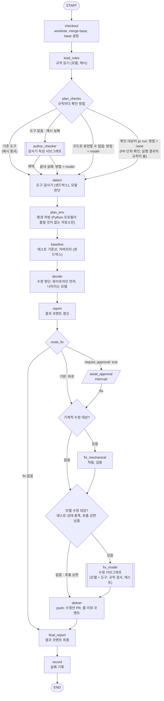
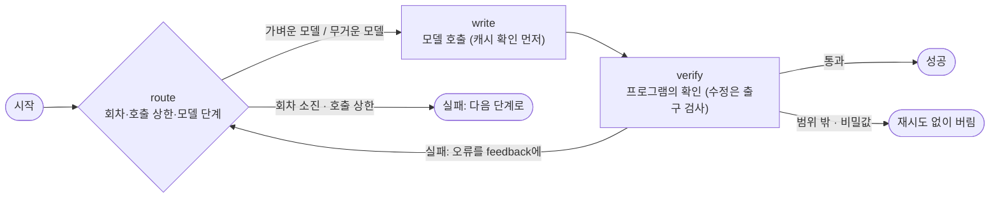

## 5. LangGraph 설계

### 5.1 메인 그래프



- 모든 노드 뒤에는 "이 커밋이 아직 최신인가" 분기가 있다. 낡았으면 END로 간다(그림에서는 뺐다).
- `plan_checks`와 `author_checker`는 규칙 묶음이 캐시에 있으면 통째로 건너뛴다.
- `detect`(지금 코드의 `detect`, `judge`, `pr_check`) 다음, 테스트 전에 `pr_description` node가 돈다(4.5 끝 "PR 설명과 diff 견주기", 2026-11-22). 규칙이 없어 규칙 경로가 일찍 끝나도 이 node를 지나 테스트로 간다. `.pipeline.yaml`의 `pr_description.enabled: false`면 아무것도 하지 않는다. 결과는 상태의 `pr_description`에만 넣고, 수정 판단과 수정 묶음은 읽지 않는다.
- `pr_description` 다음, 테스트 전에 `linked_issues` node가 돈다(4.5 끝 "연결된 이슈 확인", 2026-11-23). 규칙이 없어도 지난다. 연결된 이슈를 GitHub에서 읽고, 있으면 진행 글을 "이슈 확인"으로 고치고 모델이 견준다(없으면 진행 글도 고치지 않는다). `.pipeline.yaml`의 `linked_issues.enabled: false`면 아무것도 하지 않는다. 결과는 상태의 `linked_issues`에만 넣고(의존성 설치가 실패해도 코멘트에 보이게 `FlowContext`에도 둔다), 수정 판단과 수정 묶음은 읽지 않는다. `/fix`가 앞 node부터 다시 돌 때 이미 견준 결과가 있으면(호출 상한으로 남은 것이 아니면) 그대로 둔다.
- `linked_issues` 다음, 테스트 전에 `plan_env` node가 돈다(4.5 "Python 프로필이 돌릴 것이 없는 저장소의 테스트", 2026-11-29). PR head의 worktree에 Python 프로필이 돌릴 것이 없을 때만(`flow_state.uses_plan`, `python.has_work`가 거짓) 진행 글을 "환경 준비"로 고치고 base 커밋의 환경 처방을 정하거나 저장한 것을 쓴다(`env/plan.py`). 상태에는 처방의 참조(`env`)만 넣고 처방 본문은 `env_plans`에서 다시 읽는다. 처방은 base에만 의존하므로 새 커밋이 와도 멈추지 않고(구운 층은 다음 커밋에도 쓴다), 낡은 커밋이면 다음 분기가 END로 간다. 처방 정하기는 테스트처럼 낡았는지를 폴링하지 않아 그동안 생존 확인을 60초마다 따로 남긴다(`flow_state.keep_alive`). Python 저장소에서는 아무것도 하지 않는다. 테스트 node는 `env`를 `pr_tests`에 넘기고, `run_pr_tests`가 같은 스위치로 처방 길과 Python 프로필 길을 가른다.
- 부수 효과가 있는 노드는 `report`, `deliver`, `final_report`, `record`다. `report`와 `final_report`는 같은 코멘트를 덮어쓴다(3.1의 C5).

### 5.2 조건 분기

| 분기 | 보는 값 | 갈래 |
| --- | --- | --- |
| 낡은 커밋 | Redis의 최신 head | 계속 / END |
| 규칙의 확인 방법 | 확인 대상(4.3), 4.4의 순서와 예시 확인 결과 | 도구 / 검사기(작성 서브그래프) / 모델 판단 / PR 단위 확인(pr) / 실행 결과의 규칙(run) |
| 승인 | `fix.require_approval` | `true`일 때만 `await_approval`에서 interrupt. 기본은 바로 진행 |
| 수정 방법 | 수정 판단의 `method` | 기계적 / 모델 |
| 테스트 상태 | 테스트 상태, 불안정 여부 | 충족한 위반만 모델 수정으로. 하나도 없으면 `fix_model`을 건너뛴다. 위반 줄의 커버 여부는 보지 않는다(2026-11-21) |
| 호출 상한 | `ai_calls`로 센 호출 수와 PR 상한·저장소 하루 상한 (9.2) | 남음 / 걸림(남은 위반을 `skip`으로 바꾸고 전달로. `/fix`로 다시 돌릴 수 있다) |
| 서브그래프 안 | 출구 검사 결과, 회차, 모델 단계 | 통과 / 같은 모델로 재시도 / 무거운 모델로 / 재시도 없이 버림 / 실패 |

interrupt는 `await_approval` 한 곳뿐이다. 멈추면 상태가 체크포인트에 남고 워커는 다른 작업을 처리한다. `/fix`가 오면 `command` 작업이 `Command(resume=...)`으로 같은 thread를 이어 간다.

### 5.3 서브그래프: 같은 틀 하나, 쓰는 곳 둘

작성, 프로그램의 확인(검사기 작성은 예시 확인, 수정은 출구 검사), 이유를 넘겨 재시도, 실패 시 다음 단계. 이 틀을 한 번 만들고 프롬프트와 확인 함수만 바꿔 쓴다. 수정은 2026-11-22부터 대부분의 되풀이가 `write`의 호출 하나 안에서 모델과 도구 사이에 일어나고, 회차는 그 호출이 출구 검사에 떨어졌을 때의 뒷받침이다.



```python
def build_loop(
    name: str,
    write: Callable[[LoopState], WriteResult],     # 프롬프트 만들기 + 모델 호출
    verify: Callable[[LoopState], Verdict],        # 프로그램의 확인. 통과 / 재시도(feedback) / 버림
    policy: LoopPolicy,                            # 회차 상한, 가벼운→무거운 규칙, 호출 상한
) -> CompiledStateGraph: ...
```

| | (a) 검사기 작성 `author_checker` | (b) 수정 `fix_model` |
| --- | --- | --- |
| 입력 | 규칙 하나와 예시 | 대상 위반 묶음 |
| `write` | 검사기(ast-grep 규칙. Python 저장소는 안 되면 AST 스크립트)와 모자란 예시 작성. 도구 없이 호출 | 모델 폴더에서 테스트를 쓰고, 도구(규칙 검사, 샌드박스 테스트)로 돌려 보며 파일을 고침 + 설명 JSON. Read, Grep, Glob, Write, Edit와 파이프라인 도구 둘 (4.7) |
| `verify` | 모델이 검사기의 몫을 `part`·`none`으로 답했으면 돌리지 않고 버림(모델 판단으로). 아니면 샌드박스에서 예시를 맞게 가리는지 (4.4) | 출구 검사: 범위, 파이프라인 파일, 비밀값, 설명 JSON, 규칙 재검사, 만든 테스트, 테스트, 크기 (4.8) |
| 재시도에 넘기는 것 | 틀리게 가린 예시와 엔진의 오류 출력 | 남은 위반, 새 위반, 실패한 테스트, 고친 뒤 실패한 만든 테스트 |
| 형식 바꾸기 | Python 저장소만: ast-grep으로 2회 실패하거나, 모델이 ast-grep으로 가릴 수 없다고 답하면 그다음 회차부터 AST 스크립트로 (4.4) | 없음 |
| 실패 시 다음 단계 | 내용 규칙은 예시 확인 두 번 실패(세 번째 회차 없음)나 세 회차 소진에 확인 방법을 `model`로. 경로 규칙은 세 회차 뒤 "검사하지 못한 규칙" (4.4) | 실패 기록, 위반은 "수정안을 만들지 못함" |
| 호출 상한 | 규칙 묶음 상한 (9.2) | PR 상한 |

- v1은 수정 루프 전체가 노드 하나 안에서 돌았다. 회차 사이의 상태가 worktree에만 있어서 중간에 이어 갈 지점이 없었기 때문이다. 이제 `write`의 결과(패치)를 캐시에 저장하므로 `verify`부터 이어 갈 수 있다. worktree를 다시 만들고 저장한 패치를 적용한 뒤 검증한다.
- (a)는 worktree가 필요 없다. 상태가 전부 데이터라 어느 노드에서든 이어 간다.

### 5.4 Send 팬아웃

규칙이나 파일이 많을 때 `Send`로 나눠 돌릴 수 있게 설계하되, **처음 구현은 순차로 한다.**

| 나누는 곳 | 단위 | 합치는 방법 |
| --- | --- | --- |
| `plan_checks` → `author_checker` | 규칙 하나 | 규칙 id를 키로 한 dict에 합친다 |
| `detect`의 모델 판단 | 파일 하나 (그 파일의 hunk와 해당 규칙들) | 위반 id를 키로 합친다 |
| `fix_model` | 파일 하나 (그 파일의 위반들, 허용 범위도 그 파일 하나) | 단위별 패치를 한 worktree에 모아 4.8의 5·6을 한 번 더 한다 |

- 팬아웃을 나중에 켤 수 있게 지금부터 지키는 것: 여러 갈래가 쓰는 상태 키는 처음부터 합치는 함수(reducer)를 단다. 단위의 입력은 데이터만으로 만든다. 단위마다 자기 worktree와 자기 컨테이너 이름을 쓴다.
- 순차로 시작하는 이유: 워커의 동시 작업이 1개이고, 샌드박스 메모리 한도가 컨테이너마다 걸리고, 호출 상한을 여러 갈래가 동시에 쓰면 합계 확인이 경쟁한다. 팬아웃을 켤 때는 호출 수를 SQLite 트랜잭션으로 미리 잡는 방식이 먼저 필요하다.
- 파일별 수정 단위는 서로 다른 파일만 바꾸므로 패치가 글자로는 충돌하지 않는다. 합친 결과가 검증에 떨어지면 단위를 하나씩 쌓으며 검증하고, 떨어뜨린 단위는 실패로 기록한다.

### 5.5 그래프 상태

상태에는 경로가 아니라 데이터만 넣는다. worktree, 컨테이너, DB 연결은 실행 컨텍스트(`FlowContext`)가 들고, 재개하면 worktree를 다시 만든다.

```python
class FlowState(TypedDict, total=False):
    job: PRJob
    ruleset_key: str                                    # 규칙 묶음의 캐시 키
    rules: list[Rule]                                   # 규칙 목록 (확인·수정 방법 포함)
    unchecked: Annotated[dict[str, str], merge]         # 규칙 id → 검사하지 못한 이유
    violations: Annotated[dict[str, Violation], merge]  # 위반 id → 위반 (커버 여부 포함)
    test_run: TestRun                                   # 처방으로 돌렸으면 env(EnvUse: 처방 id, 층마다 다시 썼는지, 의존성 입력의 커밋)가 붙는다
    diff_coverage: DiffCoverage | None
    decisions: Annotated[dict[str, FixDecision], merge] # 위반 id → 수정 판단
    fixes: Annotated[dict[str, FixOutcome], merge]      # 묶음(mechanical | model) → 결과. 패치는 fix_attempts의 id
    proposals: dict[str, ProposalResult]
    carried: CarriedFrom                                # 수정안의 머지 커밋에 옮겨 적은 결과의 출처 (수정안 PR 번호, 묶음, 검증한 커밋)
    pr_description: PrDescription                       # PR 설명 확인의 결과 (4.5 끝). 알리기만 한다. 체크포인트 타입으로 등록
    linked_issues: LinkedIssues                         # 이슈 확인의 결과 (4.5 끝). 알리기만 한다. 체크포인트 타입으로 등록 (LinkedIssues, IssueGap)
    env: EnvPlanned | EnvSkipped                        # 환경 준비의 결과 (4.5). 처방 id 또는 처방이 없는 까닭의 글. 체크포인트 타입으로 등록 (env/use_pure.py)
    commented: bool
    stopped: Literal["stale", "cancelled"]
```

- 패치 본문, 모델의 응답, 검사기 본문은 상태에 넣지 않는다. 테이블에 두고 id나 키만 넣는다.
- 체크포인트에서 되살릴 수 있는 타입을 목록으로 제한한다(지금 구현의 `allowed_msgpack_modules`).

### 5.6 체크포인트, 캐시, 부수 효과

**체크포인트**

- `SqliteSaver`, thread_id는 `repo#pr#head_sha`.
- 새 검사(새 커밋의 첫 검사, `/recheck`)는 같은 thread의 이전 체크포인트를 지우고 시작한다.
- 도중에 실패하면 RQ의 재시도가 같은 thread를 실패한 노드부터 이어 간다(`invoke(None, config)`). 끝난 노드는 다시 돌지 않는다.
- 새 커밋이 오면 SHA가 달라져, 멈춰 있던 그래프는 따로 지우지 않아도 쓰이지 않는다.
- 수정안의 머지 커밋에 검증한 결과를 옮겨 적을 때(4.9 "수정안 PR 상태 관리")는 검증한 커밋의 thread에서 끝난 상태를 읽어, 고친 위반을 빼고 남은 위반의 줄 번호를 머지 커밋에 맞춘 값으로 이 커밋의 thread를 채운다(`update_state`, 수정 판단이 끝난 것처럼). 그 뒤 코멘트 node만 돌린다(`graph.carry_flow`). 그래서 이 커밋의 체크포인트와 위반 기록(`violations`)도 보통의 검사처럼 남고, 코멘트 수정(4.11)과 다음 커밋이 그것을 읽는다.

**모델 호출 결과는 그래프 상태가 아니라 해시 키 캐시 테이블에 둔다.**

- 노드는 모델을 부르기 전에 `model_cache`에서 키를 찾고, 있으면 그 결과를 쓴다. 노드가 중간에 죽어 처음부터 다시 돌아도 이미 끝난 호출은 다시 하지 않는다.
- 캐시는 thread와 무관하다. `/recheck`로 체크포인트를 지워도, 다른 PR이어도, 키가 같으면 같은 결과를 쓴다. 재현성이 여기서 나온다(9.1).

**부수 효과는 끝쪽 노드에만 두고, 다시 해도 중복되지 않게 한다.**

| 부수 효과 | 노드 | 다시 실행해도 중복되지 않는 이유 |
| --- | --- | --- |
| 결과 코멘트 | `report`, `final_report` (진행 표시 포함) | PR당 하나를 덮어쓴다. 저장한 ID, 없으면 마커와 작성자로 찾는다 |
| 브랜치 push | `deliver` | 같은 브랜치에 강제 푸시. 저장한 패치를 적용한 결과라 내용이 같다 |
| 수정안 PR 생성 | `deliver` | `proposals` 기록과 GitHub의 그 브랜치 열린 PR을 먼저 확인하고, 있으면 제목·본문만 고친다 |
| 줄 리뷰 코멘트 | `deliver` | 리뷰 본문에 `<!-- pr-proof:review <패치 해시> -->`를 넣고, 같은 마커의 리뷰가 있으면 건너뛴다 |
| 명령 답글 | `command` 작업 | 처리한 코멘트 ID 기록 |
| 과거 기록 | `record`, 수정안 PR 상태 확인 | 기록의 고유 키 (repo, 종류, 원천 id) |

저장해 둔 GitHub의 id는 사람이 지웠을 수 있다. 기록만 믿지 않고 GitHub에서 마커로 한 번 더 확인한다(`docs/JOURNAL.md` 2026-11-17).

